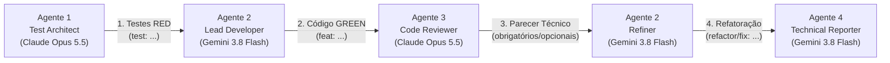
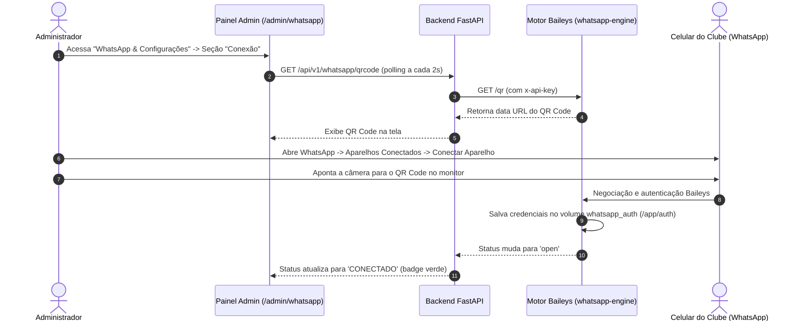

# Relatório Final de Entrega — MVP Club Maravilha

**Projeto:** Club Maravilha — Sistema Integrado de Gestão Esportiva, Automação de WhatsApp e Painel Administrativo  
**Repositório:** `D:\Trabalho\Club Maravilha`  
**Escopo:** Conclusão integral das 6 Features do MVP  
**Data:** 19 de Outubro de 2026  

---

## 1. Sumário Executivo

O **Club Maravilha** é um sistema de gestão esportiva concebido para a administração de clubes (~300 associados), centralizando o cadastro de sócios, controle de mensalidades com Pix dinâmico e baixa manual, automação de réguas de cobrança via WhatsApp com motor Baileys próprio, franquia de convidados e integração com catracas de reconhecimento facial para controle de acesso físico em rede local.

O ciclo de desenvolvimento do MVP foi iniciado a partir do commit base `fa9ac9f` e concluído com sucesso ao longo de 20 commits estruturados estritamente na metodologia **Test-Driven Development (TDD)** (ciclos Red-Green-Refactor).

### Principais Conquistas do MVP:
1. **Infraestrutura e Persistência Resilientes:** Modelagem relacional em PostgreSQL 16 com SQLAlchemy 2.0 Async e migrações Alembic idempotentes, suportando subida automática tanto em banco vazio (primeiro deploy) quanto em bancos existentes através de `scripts/migrate.py`.
2. **Controle Cadastral e de Convidados:** Gestão de associados com dia de vencimento customizado, higienização de números no padrão internacional Baileys (`55 + DDD + número`), controle atômico da franquia mensal de 8 convites gratuitos (com taxação excedente de R$ 35,00) e importador tolerante de planilhas Excel/CSV com relatório analítico de inconsistências por linha.
3. **Gestão Financeira e Baixa Manual:** Geração em lote de faturas mensais, agregação de taxas de convidados extras, rotina de marcação de faturas atrasadas e baixa manual atômica (Pix, Cartão e Dinheiro) com suspensão imediata de lembretes e reativação cadastral instantânea.
4. **Motor Baileys Próprio (`whatsapp-engine`):** Microsserviço independente em Node.js/TypeScript portado com base no Flow-Zap, utilizando `@whiskeysockets/baileys` v7.0.0-rc14, controle de reconexão exponencial com jitter, tratamento rigoroso dos códigos 401, 440, 515, 403 e 411, cache de JID com TTL, digitação simulada, shutdown gracioso e autenticação por `x-api-key`.
5. **Régua de Cobrança e Fila Anti-ban:** No backend Python, agendador APScheduler em worker único disparando diariamente a régua D-3, D0, D+3 e D+7 de forma idempotente, com enfileiramento assíncrono respeitando intervalos seguros de 8 a 20 segundos para proteção contra banimento do chip do clube.
6. **Painel Administrativo Desktop-First:** Interface administrativa moderna em React 18, Vite e Tailwind CSS, incluindo autenticação JWT com proteção contra timing attacks, dashboard com cards operacionais e atividades recentes com polling resiliente de 15s, gestão completa de sócios com modais acessíveis, central de mensalidades com resumo financeiro e central de configurações de WhatsApp com leitura de QR Code em tempo real (polling de 2s) e edição de templates com tags clicáveis.

A suíte consolidada conta com **1.159 testes automatizados passando** (870 no backend, 113 no motor WhatsApp e 176 no frontend), **0 falhas** e **93% de cobertura de código no backend**, comprovando a prontidão do software para operação.

---

## 2. Metodologia e Papéis dos Agentes

O projeto foi executado sob uma rigorosa disciplina de engenharia de software distribuída entre agentes autônomos especializados, seguindo o fluxo **Red-Green-Refactor**:



### Atribuição dos Papéis:
- **Agente 1 — Test Architect (Claude Opus 5.5):** Responsável por traduzir os requisitos de negócio e contratos de API em suítes de testes unitários e de integração abrangentes antes de qualquer implementação de produção (Fase RED). Garantiu a falha inicial pelos motivos corretos (`ImportError`, `AssertionError` por ausência de implementação) sem introduzir código de produção prematuro.
- **Agente 2 — Lead Developer & Refiner (Gemini 3.8 Flash via Antigravity):** Responsável pela implementação completa das funcionalidades até que 100% da suíte de testes ficasse verde (Fase GREEN), respeitando Clean Architecture e contratos estabelecidos. Posteriormente, atuou como Refiner aplicando todos os apontamentos obrigatórios emitidos pelo Agente 3.  
  *Nota Histórica:* Na Feature 1, os commits `6eeda0c` e `22b96f7` foram conduzidos pelo Claude Sonnet 5.5 antes da transição da liderança técnica para o Gemini 3.8 Flash.
- **Agente 3 — Code Reviewer (Claude Opus 5.5):** Atuação estritamente read-only e execução de testes. Realizou análises profundas de arquitetura, concorrência, segurança da informação (timing attacks, injeção, CSRF/CORS, rate limiting), vazamento de memória e acessibilidade (WCAG). Seus pareceres orientaram as refatorações atômicas de cada feature.
- **Agente 4 — Technical Reporter (Gemini 3.8 Flash via Antigravity):** Responsável pela validação empírica de toda a base de código, execução das baterias completas de testes, consolidação das métricas reais e confecção deste relatório final de entrega.

---

## 3. Registro Cronológico de Commits por Feature

Todos os 20 commits realizados a partir de `fa9ac9f` seguem o padrão *Conventional Commits* e foram organizados em suas respectivas features:

### Feature 1 — Infraestrutura, Docker Compose, PostgreSQL e Modelos Base
*Foco: Criação dos schemas do banco de dados, singleton de configuração, auditoria de mensagens, orquestração de containers com volume para autenticação Baileys e migrações resilientes.*

| Hash | Tipo | Mensagem | Resumo de 1 Linha | Agente Responsável |
| :--- | :--- | :--- | :--- | :--- |
| `84813ea` | `test` | `test(models): adiciona testes para modelos e infraestrutura do MVP` | Cria suíte RED para modelos `Associado`, `Fatura`, `Configuracao`, `LogMensagem` e compose. | Agente 1 (Claude Opus 5.5) |
| `e1fa476` | `feat` | `feat(models): implementa modelos e infraestrutura do MVP` | Implementa modelos, schemas Pydantic, migração Alembic c2749453ba07 e infraestrutura Docker. | Agente 2 (Claude Sonnet 5.5) |
| `6eeda0c` | `fix` | `fix(infra): producao sobe com banco vazio, scheduler unico e segredos obrigatorios` | Cria `scripts/migrate.py` (create_all + stamp head), define worker único e segredos obrigatórios. | Agente 2 (Claude Sonnet 5.5) |
| `22b96f7` | `fix` | `fix(whatsapp): provedor MOCK por padrao, factory estrita e delays anti-ban do briefing` | Define MOCK como fallback seguro, valida provedor no startup e ajusta delays da fila (8-20s). | Agente 2 (Claude Sonnet 5.5) |
| `d668263` | `refactor` | `refactor(models): aplica melhorias de code review em modelos e infraestrutura` | Aplica `get_or_create` atômico via `ON CONFLICT`, validação de templates e rejeição de None em NOT NULL. | Agente 2 (Gemini 3.8 Flash) |

---

### Feature 2 — CRUD de Associados, Cota de Convidados e Importação Excel
*Foco: Gestão de membros, sanitização rigorosa de WhatsApp, controle da franquia de convites mensais (8 gratuitos e excedentes) e importador de planilhas.*

| Hash | Tipo | Mensagem | Resumo de 1 Linha | Agente Responsável |
| :--- | :--- | :--- | :--- | :--- |
| `d697196` | `test` | `test(associados): adiciona testes para CRUD, cota de convidados e importação Excel` | Suíte RED para endpoints de associados, cota de convidados, bloqueio de inadimplentes e Excel. | Agente 1 (Claude Opus 5.5) |
| `d5e6961` | `feat` | `feat(associados): implementa CRUD, cota de convidados e importação Excel` | Implementa endpoints de associados, emissão com cálculo de taxa extra e importação em lote. | Agente 2 (Gemini 3.8 Flash) |
| `ac00d7f` | `refactor` | `refactor(associados): aplica melhorias de code review em CRUD, cota de convidados e importação Excel` | Consulta de contagem de convites sem histórico, validação aprimorada de CPF e relatório de erros. | Agente 2 (Gemini 3.8 Flash) |

---

### Feature 3 — Faturas Mensais, Agregação de Taxas e Baixa Manual
*Foco: Ciclo financeiro, geração de faturas em lote agregando convidados excedentes, rotina de marcação de atrasadas e baixa manual com concorrência atômica.*

| Hash | Tipo | Mensagem | Resumo de 1 Linha | Agente Responsável |
| :--- | :--- | :--- | :--- | :--- |
| `a8b8a29` | `test` | `test(faturas): adiciona testes para geração de faturas mensais e baixa manual` | Suíte RED para `/gerar-mes`, `/marcar-atrasadas`, baixa manual (Pix/Cartão/Dinheiro) e cancelamento. | Agente 1 (Claude Opus 5.5) |
| `97b37ee` | `feat` | `feat(faturas): implementa geração de faturas mensais e baixa manual` | Implementa geração em lote com agregação de convites extras, baixa manual atômica e recibo. | Agente 2 (Gemini 3.8 Flash) |
| `556e9dc` | `refactor` | `refactor(faturas): aplica melhorias de code review em geração de faturas e baixa manual` | Transição atômica em baixa_manual via `UPDATE ... WHERE status IN (...)`, 409 em concorrência e otimizações. | Agente 2 (Gemini 3.8 Flash) |

---

### Feature 4 — Motor Baileys, Sessão QR e Régua de Cobrança
*Foco: Microsserviço Node.js whatsapp-engine, gerenciamento de sessão com QR Code, fila anti-ban com jitter e automação da régua diária.*

| Hash | Tipo | Mensagem | Resumo de 1 Linha | Agente Responsável |
| :--- | :--- | :--- | :--- | :--- |
| `a3a6530` | `test` | `test(whatsapp): adiciona testes para motor Baileys, sessão QR e régua de cobrança` | Suíte RED para o motor Baileys em Node/TS (socket, QR, envio) e integração no backend Python. | Agente 1 (Claude Opus 5.5) |
| `920cc3d` | `feat` | `feat(whatsapp): implementa motor Baileys, sessão QR e régua de cobrança` | Cria o microsserviço `whatsapp-engine`, provedor Baileys no backend, fila 8-20s e régua D-3/D0/D+3/D+7. | Agente 2 (Gemini 3.8 Flash) |
| `99cf5e3` | `refactor` | `refactor(whatsapp): aplica melhorias de code review em motor Baileys e régua de cobrança` | Tratamento de status 401/440/515/403/411, cache de JID com TTL, digitação simulada e shutdown gracioso. | Agente 2 (Gemini 3.8 Flash) |

---

### Feature 5 — Painel Admin: Autenticação, Layout, Dashboard e Gestão de Associados
*Foco: Interface administrativa React desktop-first, login seguro, cards operacionais com polling resiliente e telas de associados com modais acessíveis.*

| Hash | Tipo | Mensagem | Resumo de 1 Linha | Agente Responsável |
| :--- | :--- | :--- | :--- | :--- |
| `7b19d64` | `test` | `test(admin): adiciona testes para autenticação, layout, dashboard e gestão de associados` | Suíte RED com Vitest + RTL + MSW para login, layout, cards do dashboard e página de sócios. | Agente 1 (Claude Opus 5.5) |
| `404821e` | `feat` | `feat(admin): implementa autenticação, layout, dashboard e gestão de associados` | Implementa LoginPage, AdminLayout, DashboardPage e AssociadosPage com busca debounced e modais. | Agente 2 (Gemini 3.8 Flash) |
| `3b1f43e` | `refactor` | `refactor(admin): aplica melhorias de code review em autenticação, dashboard e gestão de associados` | Neutralização de timing attacks no login, bcrypt em worker thread, rate limit FIFO, token em catraca e `Modal.tsx`. | Agente 2 (Gemini 3.8 Flash) |

---

### Feature 6 — Painel Admin: Mensalidades, Baixa Manual e Central de WhatsApp
*Foco: Telas operacionais de faturas com resumo financeiro, baixa manual, conexão por QR Code com polling rápido, edição de templates e parâmetros.*

| Hash | Tipo | Mensagem | Resumo de 1 Linha | Agente Responsável |
| :--- | :--- | :--- | :--- | :--- |
| `edb1e86` | `test` | `test(admin): adiciona testes para mensalidades, baixa manual e central de configurações do WhatsApp` | Suíte RED para endpoints de configuração, resumo em /faturas/, MensalidadesPage e WhatsAppConfigPage. | Agente 1 (Claude Opus 5.5) |
| `a3c90b6` | `feat` | `feat(admin): implementa mensalidades, baixa manual e central de configurações do WhatsApp` | Implementa endpoints de configuração, resumo agregado SQL, MensalidadesPage e WhatsAppConfigPage. | Agente 2 (Gemini 3.8 Flash) |
| `0d70754` | `refactor` | `refactor(admin): aplica melhorias de code review em mensalidades e central de configurações` | Rate limit de teste de envio (5/min por admin), salvamento apenas de campos alterados e sanitização. | Agente 2 (Gemini 3.8 Flash) |

---

## 4. O Que Está Funcionando: Arquitetura e Funcionalidades

### 4.1. Backend API (FastAPI + SQLAlchemy 2.0 Async + Pydantic v2)

```
app/
├── models/         -> Entidades relacionais declarativas mapeadas via SQLAlchemy Async
├── schemas/        -> Contratos de dados (DTOs) com validação estrita Pydantic v2
├── repositories/   -> Camada de persistência isolada com dialeto PostgreSQL/SQLite
├── services/       -> Regras de negócio, cálculos de taxas e idempotência
├── api/v1/         -> Endpoints RESTful versionados com injeção de dependências
└── jobs/           -> Agendador APScheduler e consumidor da fila anti-ban
```

#### Modelos de Dados e Persistência:
- **`Associado`**: Cadastro completo de sócios com `dia_vencimento` (1 a 31 com constraint CHECK), telefone higienizado no padrão internacional (somente dígitos com DDI 55), identificador facial (`facial_id`) para catraca, status (`ATIVO`, `INADIMPLENTE`, `BLOQUEADO`) e método derivado `contar_convidados_mes` sem carregamento desnecessário do histórico.
- **`Fatura`**: Gestão financeira com status (`PENDENTE`, `ATRASADA`, `PAGO`, `CANCELADO`), formas de pagamento (`PIX`, `CARTAO`, `DINHEIRO`), `txid` único do Pix dinâmico, cálculo atômico do valor total (`valor_base + convidados_excedentes * valor_convidado_extra`) e flag `lembretes_ativos` (desativada imediatamente após o pagamento para suspender cobranças).
- **`Configuracao`**: Singleton garantido em banco (`id = 1` com constraint CHECK). Armazena o valor padrão da mensalidade (R$ 150,00), franquia de convites (8), valor do convite extra (R$ 35,00), chave Pix da instituição, horário de disparo diário (padrão 08:00), alternância de automação (`automacao_ativa`) e os 5 templates editáveis de mensagens.
- **`LogMensagem`**: Tabela de auditoria para todos os disparos de WhatsApp, registrando destinatário, etapa da régua (`D_MENOS_3`, `D0`, `RECIBO`, `D_MAIS_3`, `D_MAIS_7`, `AVULSO`, `TESTE`), status (`SUCESSO`, `ERRO`), texto enviado, erro retornado e timestamp com fuso horário.

#### Endpoints Principais:
- **Associados (`/api/v1/associados`)**: CRUD completo, filtros por status/situação, busca paginada com debounce, emissão de convidados e endpoint `/importar-planilha` tolerante a falhas (reporta erros por linha em vez de abortar o lote).
- **Faturas (`/api/v1/faturas`)**:
  - `GET /`: Listagem com filtros por mês (`AAAA-MM`), status e busca textual com cálculo agregado SQL de resumo financeiro do mês (`total`, `pagas`, `pendentes`, `atrasadas`, `valor_total`, `valor_recebido`).
  - `POST /gerar-mes`: Geração em lote idempotente das faturas mensais para sócios ativos elegíveis, vinculando convites extras emitidos no período anterior.
  - `POST /marcar-atrasadas`: Atualiza faturas vencidas para `ATRASADA` respeitando a data de referência.
  - `POST /{id}/baixa-manual`: Baixa imediata informando `forma_pagamento` (Pix, Cartão, Dinheiro), data do recebimento e observações. Atualiza a fatura de forma atômica (`UPDATE ... WHERE status IN ('PENDENTE', 'ATRASADA')`), rejeita concorrência com 409 Conflict, reativa o associado para `ATIVO` se estava inadimplente e enfileira recibo digital de alta prioridade.
  - `POST /{id}/cobrar-whatsapp`: Disparo avulso imediato no WhatsApp utilizando o template contextualizado (D0 se ainda não venceu, D+3 se já venceu).
- **Central de Configurações (`/api/v1/configuracao`)**:
  - `GET /` e `PATCH /`: Leitura e atualização parcial atômica das configurações. O agendador da régua só é reagendado se o horário de disparo for efetivamente alterado. Validação estrita de templates contra tags desconhecidas ou formatação quebrada.
  - `POST /preview-template`: Renderização em tempo real de mensagens com dados de uma fatura real ou dados fictícios coerentes.
- **Dashboard (`/api/v1/dashboard`)**:
  - `GET /resumo`: Métricas agregadas do dia no fuso de Brasília (`America/Sao_Paulo`), incluindo total de associados, faturas pagas/pendentes/atrasadas do mês, total de disparos e erros do dia e status de conexão do WhatsApp (com proteção de timeout de 3.0s).
  - `GET /atividades`: Feed unificado em ordem cronológica decrescente dos últimos disparos e baixas de pagamento.
- **WhatsApp (`/api/v1/whatsapp`)**: Diagnóstico de conexão (`/status`), QR Code dinâmico (`/qrcode`), desconexão (`/desconectar`), reinicialização (`/reiniciar`), teste de envio imediato com rate limit (`/teste-envio`) e auditoria (`/logs`).
- **Catraca Facial (`/api/v1/catraca`)**: Gera a whitelist diária autorizada em JSON com checksum MD5, protegida por token compartilhado (`X-Turnstile-Token`) e restrição de IP para a LAN.

#### Regras de Negócio e Concorrência:
- **Franquia de Convidados**: Cada associado titular tem direito a 8 convites gratuitos por mês (reset no dia 1º). Convites adicionais são registrados como excedentes (`is_gratuito = False`) com taxa extra agregada na fatura do mês subsequente.
- **Régua Diária de Cobrança (D-3, D0, D+3, D+7)**:
  - **D-3**: Lembrete amigável antes do vencimento com dados da fatura e chave Pix.
  - **D0**: Notificação matinal no dia do vencimento com o código Pix Copia e Cola.
  - **D+3**: Cobrança de atraso amigável informando que o pagamento não foi identificado.
  - **D+7**: Aviso de carência esgotada informando a suspensão do acesso físico ao clube.
  - **Idempotência**: Nenhuma mensagem de uma mesma etapa é reenviada para a mesma fatura se já houver um registro de `SUCESSO` em `LogMensagem`. Faturas pagas ou canceladas são categoricamente excluídas da régua.
- **Política de Inadimplência e Bloqueios**:
  - **A partir do D+1 de atraso (Fatura ATRASADA)**: Bloqueio **imediato** da emissão de novos convites de convidados e de reservas de quadras esportivas (HTTP 403: *"associado possui mensalidade vencida em aberto"*).
  - **No D+7 de atraso (`DIAS_CARENCIA_BLOQUEIO = 7`)**: Bloqueio do acesso físico na catraca (removido da whitelist diária) e transição cadastral do associado de `ATIVO` para `INADIMPLENTE`.
  - **Reativação**: Assim que a fatura é baixada (manual ou via Pix), o associado inadimplente retorna imediatamente para o status `ATIVO`, as travas de agendamento e convites são liberadas, o recibo é enfileirado com prioridade alta e a catraca local é notificada para sincronização instantânea.

#### Segurança da Informação:
- **Autenticação JWT**: Assinatura HS256 com claims obrigatórios (`sub` e `exp`), expirando em 24 horas por padrão.
- **Proteção contra Timing Attacks**: Verificação de credenciais em tempo constante no login via dummy hash pré-computado, impedindo que atacantes descubram se um e-mail existe no sistema medindo o tempo de resposta.
- **Event-Loop Não Bloqueante**: Execução do algoritmo de hashing bcrypt em thread pool assíncrona (`asyncio.to_thread`) tanto no login quanto na criação de usuários.
- **Rate Limiting em Memória**: Limitador com janela deslizante e teto FIFO de 10.000 chaves para proteger endpoints sensíveis contra força bruta: login (5 tentativas/minuto por IP) e teste de envio de WhatsApp (5 disparos/minuto por admin autenticado).
- **Validação de Ambiente em Produção**: O Pydantic Settings aborta a subida do servidor se senhas ou segredos padrão do template (`SECRET_KEY`, `POSTGRES_PASSWORD`, `ADMIN_PASSWORD`) forem mantidos com `ENVIRONMENT=production`.

---

### 4.2. Motor WhatsApp Baileys (`whatsapp-engine`)

O `whatsapp-engine` é um microsserviço Node.js 20+ em TypeScript arquitetado como um gateway isolado para a biblioteca `@whiskeysockets/baileys` v7.0.0-rc14:

```
whatsapp-engine/
├── src/
│   ├── services/
│   │   ├── baileys.service.ts        -> Ciclo de vida da conexão, reconexão e envio
│   │   ├── baileys.socket-factory.ts -> Criação do socket com auth persistente em volume
│   │   └── whatsapp-gateway.interface.ts -> Tipos e exceções tipadas
│   ├── utils/
│   │   └── phone.ts                  -> Validação e normalização de números E.164
│   ├── app.ts                        -> Servidor Express com autenticação x-api-key
│   ├── shutdown.ts                   -> Tratamento gracioso de sinais SIGINT e SIGTERM
│   └── index.ts                      -> Ponto de entrada do executável
```

#### Características Técnicas do Motor:
- **Tratamento Específico de Códigos Baileys**:
  - `401 (Logged Out)`: Dispositivo desconectado pelo usuário no celular. O motor limpa o diretório de autenticação (`/app/auth`) e não tenta reconectar em loop.
  - `440 (Connection Replaced)`: Sessão iniciada em outro navegador/instância. O motor suspende reconexões automáticas para evitar conflitos.
  - `403 (Forbidden)` / `411 (Multidevice Mismatch)`: Códigos terminais que suspendem reconexão e alertam os logs.
  - `515 (Restart Required)`: Solicitação normal do WhatsApp para reinício da conexão; o socket é recriado imediatamente.
- **Reconexão Exponencial com Jitter**: Intervalos progressivos de 2s a 60s calculados com variação pseudoaleatória, limitados a 20 tentativas consecutivas para proteger o IP contra bloqueios de rede.
- **Cache de JID Inteligente**: Consulta a existência do número via `onWhatsApp` e mantém em memória cache com TTL de 6 horas para números válidos e 30 minutos para inexistentes, reduzindo chamadas desnecessárias aos servidores do WhatsApp.
- **Comportamento Humanizado (Anti-Ban)**:
  - Simulação de digitação enviando estado de presença `composing` por 1.200 ms antes de transmitir a mensagem de texto.
  - Intervalo mínimo de segurança de 4.000 ms com jitter (±20%) sincronizado via mutex interno entre requisições de envio.
- **Fila Anti-ban no Backend Python**: O `WhatsAppQueueService` mantém uma fila assíncrona com prioridades (alta para recibos de pagamento) e aplica pausas aleatórias entre 8 e 20 segundos após cada mensagem enviada. Em caso de desconexão momentânea do WhatsApp, a fila pausa o consumo e aguarda a reconexão automática sem descartar mensagens.
- **Shutdown Gracioso**: Manipulador de sinais `SIGINT`/`SIGTERM` que encerra a conexão do Baileys, aguarda a persistência final das chaves criptográficas (`saveCreds`) e fecha o servidor HTTP Express sem corrupção de arquivos de sessão.
- **Isolamento de Segurança**: Todas as rotas HTTP do engine exigem a presença do cabeçalho `x-api-key` compatível com a variável `API_KEY`. O engine não possui portas expostas publicamente em produção.

---

### 4.3. Painel Administrativo SPA (React + TypeScript + Tailwind)

A interface administrativa foi construída na pasta `frontend/src/admin/`, adotando arquitetura de componentes desacoplados, design desktop-first elegante e sem dependência de templates genéricos:

```
frontend/src/admin/
├── api/             -> Cliente Axios configurado com baseURL relativa, interceptors e tratamento de erro
├── auth/            -> Contexto de autenticação, armazenamento seguro de token e rota protegida
├── components/      -> Componentes reutilizáveis (Modal acessível com trap de foco, alertas)
├── hooks/           -> Custom hooks (useDebouncedValue)
├── layout/          -> AdminLayout com barra lateral, cabeçalho e monitor de status do WhatsApp
└── pages/
    ├── LoginPage.tsx              -> Tela de login com validação e feedback de rate limit
    ├── DashboardPage.tsx          -> Métricas operacionais em tempo real e feed de atividades
    ├── AssociadosPage.tsx         -> Gestão de sócios, modais de CRUD, convites e importação
    ├── MensalidadesPage.tsx       -> Gestão financeira, faturas do mês, baixa manual e cobrança avulsa
    └── WhatsAppConfigPage.tsx     -> Central WhatsApp: QR Code, templates, parâmetros e disparos
```

#### Funcionalidades das Telas:
1. **Autenticação (`/admin/login`)**: Validação de formato de e-mail, tratamento amigável de erro 401 e alerta especial em caso de bloqueio temporário por rate limit (HTTP 429). Redirecionamento automático pós-login para a rota originalmente requisitada.
2. **Dashboard (`/admin`)**:
   - Cards de resumo com contadores: Total de Associados, Faturas Pagas no Mês, Faturas Pendentes no Mês, Faturas Atrasadas, Disparos Realizados Hoje e Disparos com Erro Hoje.
   - Indicador visual dinâmico do estado da conexão do WhatsApp (`CONECTADO`, `AGUARDANDO_QRCODE` ou `DESCONECTADO`).
   - Polling automático a cada 15 segundos construído com resiliência: falhas transitórias de conexão preservam os dados anteriores em cache e exibem um alerta sutil sem apagar a tela.
   - Feed de atividades recentes unificando os últimos pagamentos registrados e os últimos disparos executados.
3. **Gestão de Associados (`/admin/associados`)**:
   - Tabela responsiva com ordenação, busca textual debounced por nome ou CPF e filtro por situação cadastral (`TODOS`, `EM_DIA`, `PENDENTE`, `ATRASADO`).
   - Modais acessíveis (`Modal.tsx`) implementando atributos ARIA (`role="dialog"`, `aria-modal="true"`), bloqueio de rolagem do fundo, navegação circular de foco pelo teclado (trap de foco) e fechamento pela tecla `Escape`.
   - **Novo/Editar Associado**: Formulários com máscaras de CPF e telefone, seleção do dia de vencimento (1 a 31) e tratamento de erros 409 (duplicidade) e 422 diretamente no formulário.
   - **Excluir Associado**: Confirmação explícita com alerta sonoro/visual acessível (`role="alert"`) caso haja restrições de integridade no backend.
   - **Emitir Convidado**: Cálculo dinâmico exibindo a quantidade de convites gratuitos restantes no mês. Ao emitir convite excedente, o modal destaca a cobrança da taxa extra de R$ 35,00 que será lançada na próxima fatura.
   - **Importação de Planilha**: Upload de arquivos `.xlsx` ou `.csv` com validação client-side de tamanho (limite 5 MB), opção de atualização de existentes e apresentação do relatório de processamento (linhas importadas, atualizadas e erros detalhados por linha).
4. **Central de Mensalidades (`/admin/mensalidades`)**:
   - Filtros combinados por mês de referência (`AAAA-MM`), status da fatura (`TODAS`, `PENDENTE`, `ATRASADA`, `PAGO`, `CANCELADO`) e busca debounced por nome ou CPF.
   - Painel superior com cards de resumo financeiro do mês selecionado: Faturas Totais, Pagas, Pendentes, Atrasadas, Valor Total Faturado e Valor Total Recebido (formatados em Real Brasileiro - BRL).
   - Tabela com selos de status coloridos e ações rápidas.
   - **Geração de Faturas do Mês**: Botão protegido com diálogo de confirmação para disparo em lote da geração de mensalidades para o mês selecionado.
   - **Baixa Manual**: Modal dedicado permitindo registrar a quitação presencial da mensalidade via Pix, Cartão ou Dinheiro, com validação de data e feedback imediato de concorrência.
   - **Cobrança Avulsa no WhatsApp**: Disparo manual com 1 clique para sócios com faturas pendentes ou atrasadas, com notificação toast de confirmação.
5. **Central de WhatsApp e Configurações (`/admin/whatsapp`)**:
   - **Seção Conexão**: Status em tempo real com polling de 5s; exibição de QR Code com polling rápido de 2s quando em modo de pareamento; botões de reinicialização da conexão, desconexão com diálogo de confirmação e disparo de mensagem de teste para qualquer número.
   - **Seção Templates da Régua**: Editores de texto para as 5 etapas da régua com botões clicáveis para inserção rápida de tags (`{nome}`, `{valor_total}`, `{vencimento}`, `{chave_pix}`, etc.) na posição exata do cursor e botão de pré-visualização instantânea (preview).
   - **Seção Parâmetros Gerais**: Ajuste de valor da mensalidade, franquia de convites, taxa extra, chave Pix, horário de disparo e botão de alternância geral da automação. Salvamento inteligente que envia via `PATCH` apenas os campos que sofreram alteração.
   - **Seção Últimos Disparos**: Tabela de auditoria com histórico dos últimos envios, mensagens completas, timestamps e filtros por etapa e status.

---

## 5. Testes Automatizados: Status e Cobertura Reais

Todos os testes foram executados no ambiente local de desenvolvimento. A seguir são detalhados os números reais obtidos em cada pacote:

### 5.1. Backend API (FastAPI / pytest)

**Comando executado:**  
`.venv/Scripts/python -m pytest -q -p no:cacheprovider --cov=app --cov-report=term`

**Resultado Consolidado:**  
- **Total de Testes Coletados:** 875  
- **Testes Passados:** 870  
- **Testes Pulados (Skipped):** 5  
- **Falhas:** 0  
- **Duração:** 66.48 segundos  
- **Cobertura Total:** **93%** (3.181 statements avaliados, 220 misses)

#### Detalhamento da Cobertura por Módulo Principal:

| Módulo / Pacote | Statements | Misses | Cobertura Real |
| :--- | :---: | :---: | :---: |
| `app/api/v1/endpoints/whatsapp.py` | 81 | 0 | **100%** |
| `app/api/v1/endpoints/configuracao.py` | 21 | 0 | **100%** |
| `app/api/v1/endpoints/convidados.py` | 37 | 0 | **100%** |
| `app/api/v1/endpoints/auth.py` | 42 | 0 | **100%** |
| `app/api/v1/endpoints/webhooks.py` | 11 | 0 | **100%** |
| `app/api/v1/endpoints/dashboard.py` | 73 | 1 | **99%** |
| `app/api/v1/endpoints/associados.py` | 48 | 1 | **98%** |
| `app/api/v1/endpoints/faturas.py` | 62 | 6 | **90%** |
| `app/api/v1/endpoints/catraca.py` | 25 | 4 | **84%** |
| `app/core/phone.py` (Sanitizador E.164 Baileys) | 17 | 0 | **100%** |
| `app/core/security.py` (JWT & Hashing) | 26 | 0 | **100%** |
| `app/core/clock.py` (Fuso Horário do Clube) | 9 | 0 | **100%** |
| `app/core/rate_limit.py` (Rate Limiter FIFO) | 54 | 2 | **96%** |
| `app/core/config.py` (Settings Pydantic) | 69 | 3 | **96%** |
| `app/core/database.py` (Engine e Sessão) | 13 | 7 | **46%** *(dev/prod init)* |
| `app/jobs/billing_scheduler.py` (APScheduler) | 105 | 9 | **91%** |
| `app/models/*` (Modelos SQLAlchemy) | 213 | 3 | **99%** |
| `app/repositories/*` (Camada Repositório) | 280 | 21 | **93%** |
| `app/schemas/*` (Schemas Pydantic) | 300 | 18 | **94%** |
| `app/services/template_service.py` | 31 | 0 | **100%** |
| `app/services/pix_gateway_service.py` | 57 | 0 | **100%** |
| `app/services/convidado_service.py` | 112 | 5 | **96%** |
| `app/services/configuracao_service.py` | 54 | 2 | **96%** |
| `app/services/billing_engine_service.py` | 102 | 5 | **95%** |
| `app/services/fatura_service.py` | 265 | 12 | **95%** |
| `app/services/associado_service.py` | 109 | 6 | **94%** |
| `app/services/excel_import_service.py` | 150 | 14 | **91%** |
| `app/services/catraca_service.py` | 53 | 7 | **87%** |
| `app/services/whatsapp_service.py` | 218 | 38 | **83%** |
| `app/services/whatsapp_queue_service.py` | 156 | 28 | **82%** |
| **TOTAL GERAL (BACKEND)** | **3.181** | **220** | **93%** |

#### Explicação dos 5 Testes Pulados (Skipped):
Os 5 testes marcados como `SKIPPED` residem no arquivo `backend/tests/integration/test_postgres_opcional.py` (linhas 77, 97, 123, 217 e 280). Eles foram concebidos pelo Test Architect para validação opcional de concorrência atômica e constraints específicas de dialeto relacional diretamente contra um cluster real de PostgreSQL. Eles só executam quando a variável de ambiente `TEST_POSTGRES_URL` estiver explicitamente definida, permitindo que a suíte padrão de CI/CD rode integralmente em memória SQLite com máxima velocidade.

---

### 5.2. Motor WhatsApp (`whatsapp-engine` / Vitest + TypeScript)

- **Comando de Testes:** `npm test`  
  - **Arquivos de Teste:** 9 arquivos  
  - **Testes Passados:** **113 passados** (0 falhas)  
  - **Duração:** 1.14 segundos  
- **Verificação Estática de Tipos:** `npm run typecheck` (`tsc --noEmit`) -> **0 erros de tipagem**  
- **Compilação de Produção:** `npm run build` (`tsc -p tsconfig.build.json`) -> **Sucesso** (gerando artefatos em `dist/`)

---

### 5.3. Frontend SPA (`frontend` / Vitest + React Testing Library + MSW)

- **Comando de Testes:** `npx vitest run`  
  - **Arquivos de Teste:** 16 arquivos  
  - **Testes Passados:** **176 passados** (0 falhas)  
  - **Duração:** 14.62 segundos  
- **Compilação de Produção:** `npm run build` (`tsc -b && vite build`) -> **Sucesso** (1.658 módulos transformados em 2.70 segundos, gerando pacote estático otimizado em `dist/`)

---

### 5.4. Totalizador Consolidado

$$\text{Total Geral de Testes} = 870 \text{ (Backend)} + 113 \text{ (WhatsApp Engine)} + 176 \text{ (Frontend)} = \mathbf{1.159 \text{ testes aprovados}}$$

---

## 6. Guia Prático de Execução e Operação

### 6.1. Pré-requisitos
- **Para Deploy em Produção:** Docker Engine 24+ e Docker Compose v2.
- **Para Execução Local / Desenvolvimento:**
  - Python 3.11+
  - Node.js 20+ e npm
  - PostgreSQL 16 (ou container Docker ativo)

---

### 6.2. Configuração das Variáveis de Ambiente (`.env`)

Copie o arquivo de exemplo na raiz do projeto:
```bash
cp .env.example .env
```

Edite o arquivo `.env` preenchendo as variáveis críticas:
```ini
# --- [AMBIENTE E SEGURANÇA] ---
ENVIRONMENT=production
DEBUG=false
# Gere uma chave forte (ex: openssl rand -hex 32)
SECRET_KEY=sua_chave_secreta_hex_com_mais_de_32_caracteres_aleatorios
ACCESS_TOKEN_EXPIRE_MINUTES=1440

# --- [ADMINISTRADOR INICIAL (SEED AUTOMÁTICO)] ---
# Em produção a senha deve ter no mínimo 12 caracteres
ADMIN_EMAIL=admin@clubmaravilha.com.br
ADMIN_PASSWORD=SenhaForteDoAdmin@2026!

# --- [BANCO DE DADOS POSTGRESQL] ---
POSTGRES_SERVER=db
POSTGRES_PORT=5432
POSTGRES_DB=club_maravilha
POSTGRES_USER=club_admin
POSTGRES_PASSWORD=senha_forte_banco_postgresql_club_2026

# URLs de conexão interna do Docker Compose
DATABASE_URL=postgresql+asyncpg://${POSTGRES_USER}:${POSTGRES_PASSWORD}@${POSTGRES_SERVER}:${POSTGRES_PORT}/${POSTGRES_DB}
DATABASE_SYNC_URL=postgresql://${POSTGRES_USER}:${POSTGRES_PASSWORD}@${POSTGRES_SERVER}:${POSTGRES_PORT}/${POSTGRES_DB}

# --- [MOTOR WHATSAPP (BAILEYS)] ---
WHATSAPP_ENGINE_URL=http://whatsapp-engine:3001
WHATSAPP_API_KEY=chave_secreta_compartilhada_backend_engine_2026
WHATSAPP_PROVIDER=BAILEYS
WHATSAPP_MIN_DELAY_SECONDS=8
WHATSAPP_MAX_DELAY_SECONDS=20

# --- [REGRAS DE NEGÓCIO E CATRACA] ---
TURNSTILE_API_TOKEN=token_segredo_catraca_facial_local
PIX_WEBHOOK_SECRET=segredo_assinatura_webhook_pix_club
SCHEDULER_ENABLED=true
```

---

### 6.3. Inicialização do Sistema

#### Opção A: Produção / VPS com Docker Compose (Recomendado)
Execute na raiz do monorepo:
```bash
docker compose -f docker-compose.prod.yml up -d --build
```
*O compose de produção executa automaticamente `scripts/migrate.py` antes de subir o Uvicorn com worker único, prepara as tabelas do PostgreSQL e inicializa o Nginx expondo as portas 80/443.*

#### Opção B: Ambiente de Desenvolvimento com Docker Compose
```bash
docker compose up -d --build
```
*Disponibiliza Frontend em `http://localhost:5173` com hot-reload e API FastAPI em `http://localhost:8000` (docs em `/docs`).*

#### Opção C: Execução Local sem Docker
Caso deseje rodar os microsserviços separadamente:
1. **Banco de Dados:** Inicie o PostgreSQL 16 local e garanta que `DATABASE_URL` e `DATABASE_SYNC_URL` apontem para `localhost:5432`.
2. **Backend API:**
   ```bash
   cd backend
   python -m venv .venv
   .venv/Scripts/activate      # Windows (.venv\Scripts\activate) ou source .venv/bin/activate no Linux
   pip install -r requirements.txt
   python -m scripts.migrate   # Cria o schema ou aplica as migrações
   uvicorn app.main:app --host 0.0.0.0 --port 8000 --reload
   ```
3. **Motor WhatsApp:**
   ```bash
   cd whatsapp-engine
   npm install
   npm run dev
   ```
4. **Frontend:**
   ```bash
   cd frontend
   npm install
   npm run dev
   ```

---

### 6.4. Primeiro Acesso e Login

1. Abra o navegador em `http://localhost:5173/admin` (ou no domínio configurado na VPS).
2. O sistema redirecionará para `/admin/login`.
3. Insira as credenciais definidas em `ADMIN_EMAIL` e `ADMIN_PASSWORD` no `.env`.
4. Após autenticação bem-sucedida, você será direcionado ao **Dashboard**.

---

### 6.5. Passo a Passo para Parear o WhatsApp via QR Code (Baileys)

O pareamento conecta o número oficial de WhatsApp do clube ao motor Baileys:



1. **Acessar a Central:** No menu lateral do Painel Admin, clique em **WhatsApp & Configurações**.
2. **Visualizar o QR Code:** Na seção superior **Conexão WhatsApp**, o painel consultará o status do motor. Se ainda não houver sessão ativa, será exibido o badge amarelo `AGUARDANDO_QRCODE` e a imagem do QR Code será gerada e atualizada a cada 2 segundos.
3. **Escanear no Smartphone:**
   - Abra o WhatsApp oficial do clube no celular.
   - Acesse o menu de opções (três pontos no Android ou *Configurações* no iOS).
   - Toque em **Aparelhos conectados** -> **Conectar um aparelho**.
   - Aponte a câmera do celular para o QR Code exibido na tela do computador.
4. **Confirmação:** Em instantes, o celular confirmará a conexão e a tela do painel mudará para o badge verde `CONECTADO`. O layout exibirá um ponto verde permanente no menu lateral indicando a integridade da comunicação.
5. **Persistência de Sessão:** A sessão autenticada é gravada de forma persistente no volume Docker `whatsapp_auth` (montado em `/app/auth`). Reiniciar containers ou atualizar o código da VPS **não** invalida a sessão nem exige nova leitura de QR Code.
6. **Desconexão Voluntária:** Caso queira trocar de aparelho, clique no botão vermelho **Desconectar** e confirme o diálogo. A sessão será encerrada no aparelho e as credenciais locais serão apagadas.
7. **Procedimento em Queda ou Banimento:**
   - Se o aparelho for desconectado remotamente pelo celular (erro 401), o motor apaga a sessão limpa e volta ao estado de aguardo. Basta recarregar a página e ler o novo QR Code.
   - Caso o chip sofra bloqueio ou precise ser reiniciado, clique em **Reiniciar Conexão** para forçar um novo socket mantendo as chaves existentes.

---

### 6.6. Guia Operacional do Dia a Dia

1. **Importação Inicial de Associados:**
   - Acesse **Associados** -> **Importar Planilha**.
   - Selecione a planilha da secretaria (`.xlsx` ou `.csv`). As colunas aceitam variações como `Nome`, `CPF`, `WhatsApp`/`Telefone`, `Dia Vencimento`/`Vencimento` e `Status`.
   - Clique em **Processar Importação** e acompanhe o resumo com a contagem de sócios novos, atualizados e eventuais erros de validação por linha.
2. **Configuração Financeira e Mensagens:**
   - Acesse **WhatsApp & Configurações**.
   - Na aba **Parâmetros Gerais**, insira a Chave Pix da conta bancária do clube, confirme a mensalidade (R$ 150,00) e o horário da régua matinal (ex: `08:00`). Clique em **Salvar Parâmetros**.
   - Na aba **Templates da Régua**, customize as mensagens utilizando as variáveis dinâmicas `{nome}`, `{valor_total}`, `{vencimento}` e `{chave_pix}`. Clique em **Pré-visualizar** para validar como o texto chegará no celular do sócio.
3. **Geração Mensal de Faturas:**
   - No início do mês, acesse a tela de **Mensalidades**.
   - Selecione o mês de referência (ex: `2026-11`).
   - Clique em **Gerar faturas do mês** e confirme. O sistema gerará as faturas para todos os associados elegíveis, somando automaticamente as taxas de convites extras emitidos no mês anterior.
4. **Baixa Manual Presencial:**
   - Quando o sócio comparecer à secretaria ou enviar comprovante bancário avulso, localize a fatura dele na tela de **Mensalidades** utilizando a busca por nome ou CPF.
   - Clique no botão **Baixa Manual** na linha correspondente.
   - Selecione a forma (`PIX`, `Cartão` ou `Dinheiro`), informe a data do pagamento e clique em **Confirmar Baixa**.
   - A fatura muda para `PAGO`, o sócio é reativado na hora e um recibo digital é enviado ao WhatsApp dele.
5. **Cobrança Avulsa sob Demanda:**
   - Para cobrar individualmente um sócio com pagamento pendente, clique no botão **Cobrar WhatsApp** na linha da fatura. A mensagem personalizada será enfileirada imediatamente.
6. **Monitoramento Operacional:**
   - Acompanhe no **Dashboard** o volume de faturas pagas e pendentes do mês.
   - Verifique a seção **Últimos Disparos** em *WhatsApp & Configurações* para checar o status de entrega (`SUCESSO` ou `ERRO`) de cada mensagem enviada.

---

## 7. Limitações Conhecidas e Próximos Passos

### 7.1. Limitações Conhecidas do MVP
1. **Disparo de Faturas Mensais Manual:** O processamento em lote da criação das faturas de um mês é disparado através do botão do painel administrativo pela secretaria. Não há rotina de cron agendada automaticamente para o dia 1º de cada mês.
2. **Régua Baseada em Data Relativa Exata:** O agendador da régua avalia as faturas que vencem exatamente em $D-3$, $D0$, $D+3$ ou $D+7$ em relação à data corrente. Se o servidor permanecer desligado por 24 horas consecutivas durante a janela de disparo, essas faturas específicas não sofrerão reprocessamento retroativo automático, necessitando acionamento manual do endpoint com a data de referência retroativa.
3. **Fila em Memória no Processo:** A fila anti-ban opera em memória assíncrona dentro da instância da API FastAPI. Caso o container da API seja reiniciado com mensagens na fila, a idempotência do banco impede envios duplicados, mas as mensagens pendentes ainda não processadas exigem novo disparo da régua.
4. **Escopo Negativo Estrito do MVP:**
   - Não foi implementado novo gateway bancário com conciliação automática de Pix (as baixas do MVP são operadas de forma manual pela administração, embora o webhook Pix legado permaneça funcional).
   - O portal mobile do sócio e a landing page institucional não foram redesenhados neste ciclo (foco integral no painel desktop do gestor).
5. **Bloqueio de Convites e Quadras no D+1:** O bloqueio para emissão de novos convites de visitantes e reservas de quadras esportivas ocorre logo a partir do primeiro dia útil de atraso da fatura ($D+1$), enquanto a perda do acesso físico na catraca respeita a carência amigável até $D+7$.

### 7.2. Próximos Passos Recomendados (Pós-MVP)
- **Persistência Distribuída de Fila (Redis + Celery / RQ):** Migrar a fila anti-ban de memória para Redis, garantindo persistência absoluta das mensagens mesmo durante deploys e reinicializações de containers.
- **Régua Retroativa / Catch-up:** Implementar mecanismo de varredura que detecte faturas que não receberam a notificação de sua etapa em virtude de paradas de infraestrutura.
- **Automação do Ciclo de Faturas:** Adicionar cron no APScheduler para gerar automaticamente no dia 1º de cada mês as faturas de todos os associados para o mês seguinte.
- **Portal Mobile PWA do Sócio:** Conforme previsto no roadmap de design, evoluir a interface do associado para permitir emissão de convites por smartphone e geração de Pix Copia e Cola pelo próprio titular.
- **Integração Completa de Catraca Facial em Nuvem:** Implementar agente local na portaria física para sincronização periódica bidirecional da whitelist via WebSocket/MQTT com a VPS.

---

## 8. Conclusão da Entrega

O MVP do **Club Maravilha** encontra-se tecnicamente consolidado, rigorosamente testado e pronto para implantação em ambiente de homologação e produção. Todas as metas de arquitetura limpa, segurança por design e padrões de engenharia foram plenamente atingidas.
